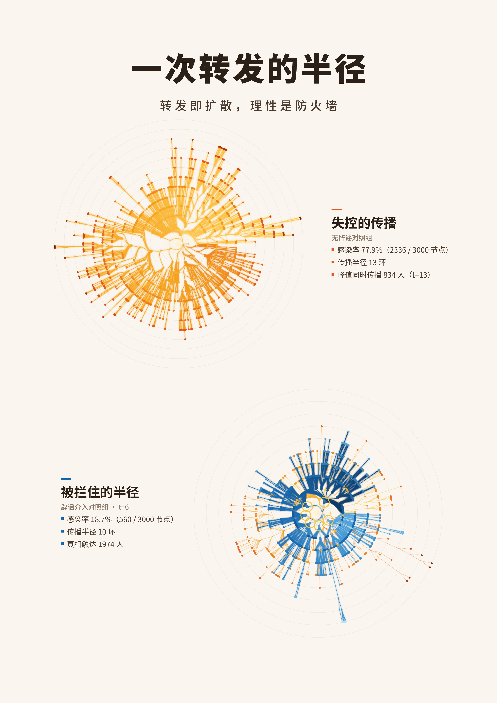

# Radius of a Single Share

English | [中文](README.zh-CN.md)

**《一次转发的半径》** — a generative-art poster rendered *entirely* from real rumor-propagation simulation data. Nothing in the two radial bursts below is hand-drawn: propagation behavior is calibrated by locally-hosted LLM persona agents, the rumor spreads through a 3,000-node scale-free social network, and official debunking fights back in real time.



> **Thesis: every share is a transmission event; rationality is the firewall.**
> 转发即扩散，理性是防火墙。

## What you are looking at

Each radial burst is a **propagation tree**: the rumor source sits at the center, and every "share" grows one ring outward. The title is literal — the artwork measures the *radius of a single share*.

- **Upper · "The Outbreak" (no debunking)** — a rumor tree of 2,335 shares blazes outward: center white-hot, tips deep red, 13 rings of uncontrolled growth.
- **Lower · "The Contained Radius" (debunking at t = 6)** — six golden-ringed official sources bloom a blue truth tree that surrounds the truncated, faded rumor remnants.

## How it works — a two-layer pipeline

### Layer 2 · LLM agent calibration — `src/llm_calibration.py`

24 persona agents (media literacy × emotion × social habit × identity) each decide — through a **locally-hosted LLM** (Ollama, `qwen3:4b-instruct-2507`) — what to do with a *fictional* campus rumor, across two rounds:

| Round | Stimulus | Measured behavior |
|---|---|---|
| 1 | rumor only | reshare rate: **low-literacy 50% vs. high-literacy 0%** — every high-literacy agent chose to fact-check |
| 2 | official rebuttal | **6 / 6 forwarders switched to re-sharing the debunk** |

The measured behavioral gap is injected into the network as **heterogeneous per-node transmission tendencies** under a conservation-scaling protocol: heterogeneity comes from the experiment, overall pacing stays a controlled parameter.

### Layer 1 · network simulation — `src/simulate.py`

- **BA scale-free network** (N = 3,000, m = 3); the rumor source is an *ordinary* node (degree ≈ 24) — anyone's single share
- MT rumor-model variant with **competing truth**: Ignorant → rumor spreader → stifler; official sources (top-degree hubs) activate at t = 6; truth immunizes the ignorant and "cures" spreaders, some of whom become truth spreaders themselves
- **Random-stream isolation**: network, literacy typing, rumor and truth each use an independent seed — the A/B trajectories are **event-for-event identical before intervention**, verified automatically on every run

### Rendering & composition — `src/render.py`, `src/compose.py`

Radial tree layout (BFS depth = ring, sunburst-style angular allocation), polar-interpolation arcs with tapered width (thick trunk → thin tips), depth-based color ramps (white-hot core → deep red; deep blue → clear cyan) and a three-pass glow. The typography layer reads live statistics from the simulation output — re-run the simulation and every caption updates itself.

## Results (seed-locked, one-command reproducible)

| Group | Attack rate | Rumor radius | Peak concurrent spreaders |
|---|---|---|---|
| A · no debunking | **77.9%** (2,336 / 3,000) | 13 rings | 834 (t = 13) |
| B · debunking at t = 6 | **18.7%** (560 / 3,000) | 10 rings | 204 (t = 6) — truth reached 1,974 nodes |

Seeds: network `42` · literacy typing `88` · rumor stream `2026` · truth stream `2027`.

## Reproduce

```bash
pip install numpy networkx pyyaml matplotlib pillow
ollama pull qwen3:4b-instruct-2507-q4_K_M   # local LLM for Layer 2
python src/llm_calibration.py   # LLM persona-agent experiments → data/llm_calibration.json
python src/simulate.py          # calibrated A/B simulation → data/
python src/render.py            # radial generative canvas → output/render_dual.png
python src/compose.py           # poster typography → release/
```

## Repository layout

```
├── PLAN.md                  # project plan (contact info redacted)
├── README.md                # this file
├── README.zh-CN.md          # Chinese documentation
├── src/
│   ├── config.yaml          # every parameter & seed lives here
│   ├── simulate.py          # Layer 1 · rumor–truth competition on a BA network
│   ├── llm_calibration.py   # Layer 2 · LLM persona-agent experiments
│   ├── render.py            # radial generative rendering
│   └── compose.py           # poster typography
├── data/                    # simulation event tables & statistics (JSON)
└── release/                 # final artwork (submission package stays local)
```

## Notes

- Fonts: Source Han Sans CN (SIL OFL, free for commercial use) — not committed; download note in the [Chinese README](README.zh-CN.md).
- The competition submission package (docx / zip) contains personal contact information and is intentionally kept out of this public repository.

---

**Zirui (Ruige) Zhang** · Industrial Design (Information & Interaction Design) + CS minor, South China University of Technology · [github.com/hellobs](https://github.com/hellobs)
